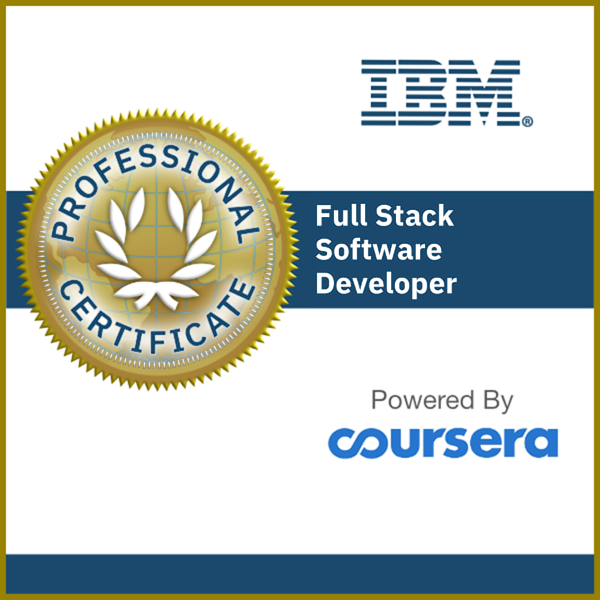

<h1 align="center">Hi 👋, I'm Rafael Susano</h1>

  Full Stack Shopify Developer & CRO Focused E-commerce Specialist

  

<!-- Main Tech Stack (Card-style icons) -->
## 💻 Tech I Work With

  
  
  
   
  
   
  

<h2 align="center">🏆 Certifications & Credentials</h2>

  
  &nbsp;&nbsp;
  

  <strong>IBM Full Stack Software Developer Professional Certificate</strong>
  ·
  <a href="https://www.credly.com/badges/271d750e-eb8c-48fe-9235-cfaba5f20a66/public_url">Verify</a>
   
  <strong>Generative AI Essentials for Software Developers</strong>
  ·
  <a href="https://www.credly.com/badges/9ac5be41-6087-4d55-b705-50f56dfea2c2/public_url">Verify</a>

<h2 align="left">📊 Analytics</h2>

  

